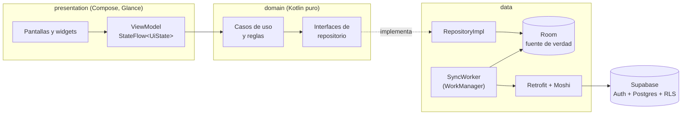

# Miti — "La casa, miti y miti"

App Android para que **dos personas que conviven** coordinen las rutinas, las tareas, las compras y los gastos
del hogar en un solo lugar, también sin conexión.

TPO de **Desarrollo de Aplicaciones I** (UADE, 2026, 2.º cuatrimestre). Integrantes: **Rocío Bottinelli** (UI/UX
y presentación) y **Juan Cruz Bautista Serra** (datos y sincronización).

| Documento | Qué es |
|---|---|
| [docs/preentrega-miti.pdf](docs/preentrega-miti.pdf) | Etapa 1: problema, usuarios, alcance, requisitos, pantallas y arquitectura (D01–D11). |
| [docs/correcciones-preentrega.md](docs/correcciones-preentrega.md) | Devolución docente de la preentrega (C1–C7). |
| [CAMBIOS.md](CAMBIOS.md) | Cada desvío respecto de la preentrega, con su problema, qué cambió y qué riesgo resuelve. |
| [docs/pruebas.md](docs/pruebas.md) | Pruebas manuales en dos dispositivos y de accesibilidad, con el resultado observado. |
| [docs/guion-demo.md](docs/guion-demo.md) | Guion de la demo: problema, escenario, acción, respuesta y valor. |
| [supabase/README.md](supabase/README.md) | Backend: esquema, reglas de acceso por hogar y cómo configurarlo desde cero. |

---

## El problema

En un hogar compartido, las tareas, las compras y los gastos están relacionados (una compra genera un gasto),
pero se manejan por canales separados: un grupo de WhatsApp, las notas del celular, un calendario en la
heladera y un Excel a fin de mes. Nadie ve de un vistazo qué falta, quién se ocupa de qué ni cómo se
repartieron los gastos. Una persona carga con recordar, pedir y controlar; la otra depende de que le avisen.

**Propuesta de valor:** las obligaciones del hogar a la vista y las cuentas siempre al día, sin que una
persona tenga que recordar, pedir ni consolidar.

## Qué hace

| Ítem | Ejemplo | Cómo funciona |
|---|---|---|
| **Rutina** | Darle de comer a Pancho, 2 veces por día | Sin responsable fijo. Cualquiera la marca, desde la app o **desde el widget sin abrir la app**. Queda quién y a qué hora ("Tomás · 8:15") y se reinicia cada día. |
| **Tarea** | Pagar el ABL el jueves a las 18 | Una sola vez, con responsable. Si tiene aviso, **suena en el celular del responsable** a la hora fijada, aun sin conexión, y se puede marcar como hecha desde la notificación. |
| **Compra** | Leche | Lista compartida: se tacha en el súper y pasa al carrito. Al terminar la compra, la app **ofrece registrar el gasto** y lo deja vinculado. |
| **Gasto** | Supermercado $ 24.000, a medias | Quién pagó, a medias o de uno solo, cuotas iguales. Alimenta un **balance mensual** que se calcula solo. Se registran pagos totales o parciales, y lo que no se salda pasa al mes siguiente. |

Pantallas: primer uso (onboarding, crear cuenta o ingresar, crear un hogar o unirse con un código, permiso de
notificaciones), **Hoy**, **Compras**, **Balance** (barra inferior), formulario de gasto y **Ajustes** (desde el
avatar). Además, dos widgets de pantalla de inicio (4x2 y 2x2) y notificaciones de tareas.

Cada pantalla contempla sus estados: carga, contenido, vacío, error con reintentar, sin conexión, datos
desactualizados, cambios pendientes de enviar y permisos rechazados.

### Requisitos funcionales alcanzados

| RF | Qué pide | Estado |
|---|---|---|
| **RF01** Registrar un ítem | Crear una rutina, una tarea (con responsable, fecha, hora y aviso) o una compra. Aparece al instante, aun sin conexión, y en el otro celular al sincronizar. | ✅ Completo |
| **RF02** Consultar lo de hoy | Rutinas del día con su progreso y quién las marcó, en la app y en el widget; próximas tareas filtrables por responsable. Sin conexión muestra lo último guardado y la hora de la última sincronización. | ✅ Completo |
| **RF03** Completar un ítem | Marcar una rutina (app o widget), una tarea (app o notificación) o una compra. Al terminar una compra, ofrecer registrar el gasto. | ✅ Completo |
| **RF04** Gastos, pagos y balance | Registrar y editar gastos (a medias o de uno solo, en cuotas), registrar pagos y ver quién le debe a quién en el mes, con el saldo de meses anteriores. | ✅ Completo |

Los requisitos no funcionales más importantes y cómo se cumplen:

| RNF | Cómo se cumple |
|---|---|
| RNF01 Todo funciona sin conexión | Room es la única fuente de verdad (D04); la red solo sincroniza. |
| RNF02 Nada se pierde y se envía en menos de 1 minuto | Cada cambio queda `PENDIENTE` en Room y dispara la sincronización enseguida; WorkManager reintenta hasta que sale. |
| RNF03 Widget en un toque | El widget marca la rutina con el mismo caso de uso que la app. |
| RNF05 Widget y app iguales en menos de 5 s | Los widgets observan Room y se actualizan cuando cambia. |
| RNF06 Avisos con ±5 min | Alarmas exactas con `USE_EXACT_ALARM`, que se reprograman al reiniciar el teléfono. |
| RNF08 TalkBack y fuente al 200 % | Probado; ver [docs/pruebas.md](docs/pruebas.md). |
| RNF10 Cada hogar ve solo lo suyo | Row Level Security en Postgres, verificado con un script SQL. |
| RNF11 El balance coincide con el cálculo manual | Regla del dominio con tests de casos límite. |
| RNF12 Android 8.0 o superior | `minSdk 26`. |
| RNF13 Dominio sin Android | El paquete `domain` es Kotlin puro. |

---

## Cómo ejecutarla

### Requisitos

- Android Studio (o JDK 21 y el Android SDK con la plataforma 37).
- Un celular o emulador con **Android 8.0 o superior**. Para probar la sincronización hacen falta dos.
- Un proyecto de Supabase. Sin él la app compila y funciona en un solo celular, pero no sincroniza.

### 1. Configurar el backend

Seguir [supabase/README.md](supabase/README.md):

1. Crear el proyecto.
2. Correr las cuatro migraciones de `supabase/migrations/` en orden.
3. Correr `supabase/tests/verificar_acceso_por_hogar.sql`, que tiene que terminar con `OK`.

Después, copiar en `local.properties`, en la raíz del repo (no se commitea):

```properties
SUPABASE_URL=https://<ref-del-proyecto>.supabase.co
SUPABASE_PUBLISHABLE_KEY=sb_publishable_...
```

La clave publicable puede ir dentro de la app: sin una sesión no da acceso a ningún dato. La contraseña de la
base y la `service_role` **nunca** van al repo ni a la app.

### 2. Compilar e instalar

Desde Android Studio: abrir el proyecto y correr la configuración `app`. Por consola:

```bash
./gradlew installDebug
```

### 3. Usarla con dos celulares

1. En el celular A: crear una cuenta, tocar **Crear mi hogar** y copiar el código de 6 caracteres.
2. En el celular B: crear otra cuenta, ir a **Unirme con un código** y pegarlo.
3. Desde ahí, lo que hace uno le llega al otro. Con la app abierta, en 15 segundos como mucho; con la app
   cerrada, al abrirla o cada 15 minutos.

### Tests

```bash
./gradlew testDebugUnitTest   # ~280 tests: dominio, ViewModels, sync, Room, alarmas
./gradlew lintDebug
```

Los tests de punta a punta contra el Supabase real (dos "celulares" que sincronizan entre sí) solo corren si se
les pide, porque crean datos en el proyecto. Usan dos cuentas de prueba (`ana.prueba@miti.test` y
`tomas.prueba@miti.test`) cuyas contraseñas se pasan por variables de entorno:

```bash
MITI_E2E=1 PRUEBA_ANA_PASSWORD=… PRUEBA_TOMAS_PASSWORD=… ./gradlew testDebugUnitTest --tests '*E2E*'
```

---

## Arquitectura final

MVVM con tres capas de Clean Architecture y un enfoque **offline first**: la pantalla solo conoce al ViewModel,
el ViewModel solo conoce casos de uso, y el dominio define las interfaces que implementa la capa de datos.



**Flujo de un dato.** Cuando la persona marca una rutina:

1. El ViewModel llama a `MarcarRutinaUseCase`.
2. El repositorio la guarda en Room como `PENDIENTE`.
3. La pantalla se actualiza sola, porque observa un `Flow` de Room.
4. En paralelo, el `SyncWorker` la sube a Supabase.
5. El otro celular la descarga en su siguiente sincronización, la guarda en su Room y su pantalla se actualiza.

Ninguna pantalla lee de la red.

### Paquetes

```
ar.edu.uade.miti
├─ core/            Resource (éxito o error), rutas de navegación tipadas
├─ domain/          Kotlin puro: modelos, interfaces de repositorio, casos de uso y reglas
│  ├─ model/        Rutina, Pendiente (tarea o compra), Gasto, Pago, BalanceDelMes, ConflictoDeGasto…
│  ├─ repository/   Interfaces que implementa data
│  └─ usecase/      Uno por operación: MarcarRutinaUseCase, TerminarCompraUseCase, RegistrarGastoUseCase…
├─ data/
│  ├─ local/        Room (AppDatabase, DAOs, entidades, migraciones) y DataStore (sesión, hogar, cursores)
│  ├─ remote/       Retrofit con los servicios de Supabase y sus DTOs
│  ├─ mapper/       DTO ⇄ dominio ⇄ entidad
│  ├─ repository/   Implementaciones
│  ├─ sync/         Sincronizador, SyncWorker, ProgramadorDeSync, MonitorDeConexion
│  └─ avisos/       Alarmas de tareas, notificaciones y receptores (reinicio, "Marcar como hecha")
├─ presentation/    Una carpeta por pantalla (Screen + Contenido sin estado + ViewModel + UiState),
│                   components/, theme/ y widget/ (Glance)
└─ di/              Módulos de Hilt
```

### Decisiones de la preentrega (D01–D11)

| | Decisión |
|---|---|
| D01 | MVVM: un ViewModel por pantalla con un único `StateFlow<UiState>` y eventos de una sola vez por `SharedFlow`. |
| D02 | Tres capas; las reglas (balance, cuotas, reinicio diario) viven en el dominio y se testean con JUnit. |
| D03 | El widget y la notificación usan los mismos casos de uso que la app, vía Hilt; nunca escriben directo en Room. |
| D04 | Room es la única fuente de verdad; la UI nunca lee de la red. |
| D05 | Repositorios como interfaces en el dominio; Supabase queda encerrado en la capa de datos. |
| D06 | Sincronización con WorkManager: sube lo pendiente y después descarga, con reintentos y espera creciente. |
| D07 | IDs UUID generados en el celular y borrado lógico (`deleted`). |
| D08 | Las marcas de rutina solo se agregan; en el resto gana la última modificación. **Gastos: se detecta el conflicto y se avisa (C2).** |
| D09 | Lo derivado (balance, progreso) se calcula, no se guarda. |
| D10 | Avisos con AlarmManager y notificaciones locales, reprogramados al reiniciar el teléfono. |
| D11 | Backend central en Supabase (Auth, Postgres con RLS, API REST); los celulares no hablan entre sí. |

---

## Tecnologías

| Para qué | Qué se usa |
|---|---|
| Lenguaje y UI | Kotlin 2.3, Jetpack Compose con Material 3, Glance (widgets) |
| Navegación | Navigation Compose con rutas tipadas (kotlinx.serialization) |
| Estado y asincronía | ViewModel, `StateFlow` y `SharedFlow`, corrutinas y Flow |
| Inyección de dependencias | Hilt (también en el widget, los receptores y los workers) |
| Persistencia local | Room 2.8 (esquema exportado y migración probada), DataStore |
| Red | Retrofit 3, OkHttp 5 y Moshi con KSP |
| Segundo plano | WorkManager (sincronización), AlarmManager (avisos) |
| Backend | Supabase: Auth, Postgres con Row Level Security y PostgREST |
| Tests | JUnit 4, kotlinx-coroutines-test, Turbine, MockWebServer, Robolectric, Room Testing |

---

## Decisiones relevantes

El detalle de cada una está en [CAMBIOS.md](CAMBIOS.md). Las más importantes:

- **Conflictos en gastos (C2).** La preentrega aceptaba que, si los dos editaban el mismo gasto sin conexión,
  una edición se perdiera sin aviso. El docente lo marcó, y ahora el **servidor detecta** la edición hecha sobre
  una versión vieja: no la deja pisar y se la avisa a quien la hizo. El aviso dice qué campo cambió ("Quién
  pagó: vos pusiste Tomás y quedó Ana") y deja elegir entre "Usar mi cambio" y "Dejar como está". No depende
  del reloj de los celulares.
- **Datos desactualizados (C1).** Si la información llega tarde, se pueden repetir tareas. Por eso:
  - Hoy y Compras muestran "Sin conexión · última sincronización hh:mm", y "Puede que no veas lo último de
    Tomás" si pasaron más de 30 minutos sin sincronizar.
  - Antes de marcar una rutina con datos viejos, la app pregunta.
  - Cada ítem sin enviar tiene su ícono.
  - Compras no deja repetir un ítem que ya está en la lista.
- **Sincronización cada 15 segundos con la app en pantalla.** Supabase no le avisa a un celular que el otro
  cambió algo (el push desde el servidor quedó fuera de alcance), así que, mientras la app está visible, se
  pregunta cada 15 s. Cada consulta baja solo lo nuevo. En segundo plano se sincroniza cada 15 minutos, para
  no gastar batería.
- **Gana la última modificación también en el servidor**, con un trigger. Sin él, el último en *sincronizar*
  pisaba al último en *editar*.
- **El aislamiento entre hogares lo aplica Postgres** con RLS, no la app. Crear un hogar y unirse son funciones
  del servidor: el código y el límite de dos integrantes no se pueden saltear.
- **Alarmas exactas con `USE_EXACT_ALARM`.** Desde Android 14, el permiso habitual viene negado y las alarmas
  se corrían hasta 35 minutos (probado en un emulador).
- **Convenciones de la cátedra.** Moshi con KSP en lugar de kotlinx.serialization para la red, sufijos
  `UseCase`, `Repository` y `Entity`, y `Resource` para los errores en lugar de excepciones.

---

## Limitaciones conocidas

- **Sincronización casi inmediata, no instantánea.** Con los dos celulares con la app abierta, un cambio tarda
  hasta 15 s en llegar; con la app cerrada, hasta que se abra o pasen 15 minutos. Supabase Realtime lo bajaría
  a 1–2 s, pero suma una librería y se acerca al push que quedó fuera de alcance.
- **El widget no pregunta antes de marcar con datos viejos**, como sí hace Hoy, porque un widget no puede
  mostrar diálogos y el requisito es un toque. En cambio, muestra "Sin conexión" o "Puede no estar al día".
- **Dos compras iguales agregadas sin conexión** en los dos celulares quedan repetidas. El aviso de datos
  desactualizados lo advierte.
- **Terminar una compra con gasto** se guarda en dos escrituras: si la segunda fallara, el gasto queda y la
  compra sigue abierta. La base local falla muy poco; lo correcto sería una sola transacción.
- **Los tokens de sesión** se guardan en DataStore sin cifrar, dentro del almacenamiento privado de la app. Una
  versión real los cifraría con Android Keystore.
- **Cerrar sesión borra los datos locales** aunque haya cambios sin enviar.
- **Resolver un conflicto de gasto** se recuerda solo en ese celular: si se reinstala la app, reaparece.
- **`USE_EXACT_ALARM`** está restringido en Google Play a apps de alarmas, calendario o recordatorios. Si Miti
  se publicara, habría que justificarlo en la ficha.
- **Fuera de alcance** (preentrega, sección 8): hogares de más de dos personas, recurrencias complejas, push
  desde el servidor, recuperar la contraseña, ingresar con Google, categorías, repartos arbitrarios y pagos
  reales.

---

## Forma de trabajo

- **Ramas:** `main` (entregas), `develop` (integración) y `feature/…` o `fix/…` desde `develop`. Todo entra por
  PR revisado por la otra persona y vinculado a un issue.
- **Commits** chicos, en español, con prefijo (`feat(data): …`, `fix(ui): …`, `docs: …`).
- **Código, comentarios y documentación** en español, incluidos los nombres del dominio (`Rutina`, `Gasto`,
  `MarcarRutinaUseCase`).
- **Uso de IA:** se usaron asistentes como apoyo para escribir código, revisar y diagnosticar. Todo lo que se
  incorporó pasó por PR y revisión, con tests, y cada integrante puede explicarlo. Cada problema que destrabó
  la IA quedó documentado en CAMBIOS.md (problema → qué cambió → cómo se probó).
