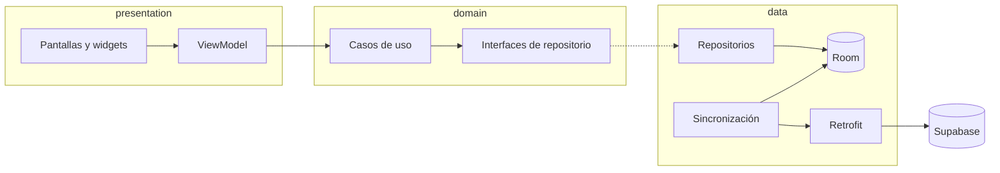

# Miti

Miti es una app Android para dos personas que viven juntas. Sirve para organizar lo de todos los días (sacar
la basura, darle de comer al perro), las tareas con fecha (pagar el ABL el jueves), la lista del súper y los
gastos compartidos. Todo queda en un mismo lugar y los dos celulares ven lo mismo.

Es el trabajo práctico de Desarrollo de Aplicaciones I (UADE, segundo cuatrimestre de 2026), hecho por Rocío
Bottinelli (diseño e interfaz) y Juan Cruz Bautista Serra (datos y sincronización).

Otros documentos del repo:

- [docs/preentrega-miti.pdf](docs/preentrega-miti.pdf): la primera entrega, con el problema, el alcance, los
  requisitos y la arquitectura planeada.
- [docs/correcciones-preentrega.md](docs/correcciones-preentrega.md): la devolución del docente sobre esa entrega.
- [CAMBIOS.md](CAMBIOS.md): todo lo que cambió respecto de la preentrega y por qué.
- [docs/pruebas.md](docs/pruebas.md): las pruebas manuales con dos celulares y de accesibilidad.
- [docs/guion-demo.md](docs/guion-demo.md): el guion de la demo.
- [supabase/README.md](supabase/README.md): el backend y cómo armarlo desde cero.

## Por qué la hicimos

Cuando dos personas conviven, la organización de la casa suele estar repartida en varios lados: el grupo de
WhatsApp para pedir cosas, una nota en el celular para el súper, un recordatorio para los vencimientos y una
planilla (o la memoria) para saber quién puso cuánta plata. Casi siempre una de las dos termina siendo la que
se acuerda de todo y le avisa a la otra.

La idea de Miti es que no haga falta avisar: lo que hay que hacer y cómo están las cuentas se ve en la app, y
cada uno se entera solo.

## Cómo se usa

### Primer uso

La primera vez, la app muestra tres pantallas cortas que explican qué se puede hacer. Después pide crear una
cuenta (nombre, email y contraseña) o ingresar con una que ya existe.

Con la cuenta creada, una de las dos personas toca **Crear mi hogar**. La app genera un código de seis
caracteres, por ejemplo `K7P2QX`, que se puede copiar o mandar por WhatsApp. La otra persona crea su cuenta,
elige **Unirme con un código** y lo escribe. Un hogar tiene como máximo dos integrantes, y eso lo controla el
servidor, no la app.

Por último, la app pide permiso para mostrar notificaciones. Se puede decir que no: la app funciona igual,
pero no suenan los avisos de las tareas, y la pantalla Hoy lo recuerda con un cartel.

### La pantalla Hoy

Es la pantalla principal. Arriba están las **rutinas del día** y abajo las **próximas tareas**. El botón "+"
permite agregar una rutina, una tarea, una compra o un gasto.

Una **rutina** es algo que se repite: todos los días o solo algunos (por ejemplo, sacar la basura los lunes,
miércoles y viernes), y una, dos o tres veces por día. No tiene responsable: la hace quien puede. Al tocarla
queda marcada, con el nombre de quien la hizo y la hora ("Hecha · Tomás 8:15"). Si es de dos veces por día,
muestra el avance ("1 de 2"). A la medianoche vuelven todas a cero.

Si alguien se equivoca, vuelve a tocar la rutina y se desmarca. Solo se puede desmarcar lo que marcó uno: si
la marcó la otra persona, la app lo dice en lugar de desmarcarla, para que nadie borre lo que hizo el otro.

Una **tarea** se hace una sola vez. Tiene fecha, hora, responsable y, si se quiere, un aviso. Cuando llega la
hora, el celular del responsable muestra una notificación con un botón "Marcar como hecha", aunque no tenga
internet. Si la tarea la creó la otra persona, también llega una notificación avisando que te la asignaron. La
lista se puede filtrar para ver todas, solo las mías o solo las de la otra persona. Si una tarea ya pasó y no
se hizo, aparece como "Atrasada".

Al tocar una tarea queda hecha: se tacha y baja al final de la lista hasta que pasa su día, así que también se
puede volver a tocar para dejarla pendiente. Cuando está todo hecho, arriba aparece "Todo al día por hoy".

Las rutinas y las tareas se borran desde el menú de tres puntos de cada fila. La app pide confirmación porque
desaparecen de los dos celulares.

### Compras

Es una lista compartida. Se escribe lo que falta abajo y se agrega. En el súper, cada cosa que se agarra se
toca y pasa a "En el carrito". La app no deja agregar algo que ya está en la lista, para no comprarlo dos
veces.

Al terminar, se toca **Terminé la compra** y lo que estaba en el carrito sale de la lista. Antes, la app
pregunta si se quiere registrar el gasto: si se dice que sí, abre el formulario de gasto y lo deja vinculado a
esa compra. Si se borra un ítem por error, aparece un "Deshacer" durante unos segundos.

### Gastos y balance

Un gasto tiene descripción, monto, quién lo pagó y cómo se reparte:

- **A medias:** cada uno pone la mitad.
- **Solo de una persona:** por ejemplo, remedios que son solo de Tomás. Si los pagó Ana, Tomás le debe todo.
- **En cuotas:** el monto se divide en cuotas iguales y cada mes cuenta solo la que corresponde. Si la compra
  ya venía con cuotas pagadas, se indica en cuál se está.

La pantalla **Balance** muestra, para cada mes, quién le debe a quién y cuánto, con la lista de movimientos.
Cuando alguien le devuelve plata al otro, se registra un **pago** (puede ser por el total o por una parte). Lo
que no se saldó en un mes pasa al siguiente como "De meses anteriores".

Un ejemplo de un mes:

| Movimiento | Efecto |
|---|---|
| Ana pagó la heladera, $ 600.000 en 6 cuotas, a medias | Este mes cuenta la cuota de $ 100.000: Tomás le debe $ 50.000 a Ana |
| Tomás pagó Internet, $ 24.990, a medias | Ana le debe $ 12.495 a Tomás |
| Tomás le pagó $ 30.000 a Ana | Se descuenta |
| **Resultado** | **Tomás le debe $ 7.505 a Ana**, que pasan al mes siguiente si no se pagan |

El balance no se guarda en ningún lado: se calcula cada vez a partir de los gastos y los pagos. Así no hay
forma de que quede desactualizado, y la regla se puede probar con tests sin abrir la app. Si se edita o se
borra un gasto, o se borra un pago, el balance se recalcula solo.

### El widget

Hay dos widgets para la pantalla de inicio. El grande muestra las rutinas del día y el chico muestra la próxima
rutina que falta. En los dos, una rutina se marca con un solo toque, sin abrir la app, y se desmarca igual que
en Hoy. Si el celular está sin conexión o hace rato que no se sincroniza, el widget lo dice.

### Ajustes

Se entra tocando el avatar. Muestra quiénes son los integrantes del hogar, el código para invitar (por si la
otra persona todavía no se unió), el estado de las notificaciones y la opción de cerrar sesión.

## Cómo se sincronizan los dos celulares

Cada celular guarda todo en una base de datos propia (Room). La app siempre lee y escribe ahí, nunca
directamente en internet. Por eso funciona igual en modo avión: se puede marcar, agregar y registrar gastos,
y todo se ve al instante.

Cada cambio queda guardado como "pendiente de enviar". Cuando hay conexión, la app lo manda al servidor
(Supabase) y después le pide al servidor lo que cambió la otra persona. Los celulares nunca hablan entre sí:
siempre pasan por el servidor.

Esto pasa cada 15 segundos mientras la app está abierta, cada vez que alguien hace un cambio, al abrir la app
y, con la app cerrada, cada 15 minutos. En la práctica, si los dos tienen Miti abierta, un cambio en un
celular aparece en el otro en menos de 15 segundos.

El problema de trabajar sin conexión es que uno puede estar viendo datos viejos. Para eso:

- Si no hay internet, Hoy y Compras dicen "Sin conexión" y a qué hora fue la última sincronización.
- Si pasó más de media hora sin sincronizar, avisan que puede que no se vea lo último de la otra persona.
- Con datos viejos, antes de marcar una rutina la app pregunta, porque quizás el otro ya la hizo.
- Lo que todavía no se envió tiene un ícono, para saber que el otro no lo ve.

Si los dos cambian lo mismo, en casi todo gana el último cambio. En los gastos no, porque perder un cambio de
plata sin enterarse es grave. Si Ana edita un gasto que Tomás ya había cambiado, el servidor no deja que el
cambio de Ana pise el de Tomás, y a Ana le aparece un aviso que dice qué quedó distinto (por ejemplo, "Quién
pagó: vos pusiste Tomás y quedó Ana"). Ana elige si usar su cambio o dejarlo como está.

## Qué pedía el trabajo y qué se hizo

Los cuatro requisitos funcionales de la preentrega están implementados:

| Requisito | Qué hace la app |
|---|---|
| RF01. Registrar un ítem | Crear rutinas, tareas (con responsable, fecha, hora y aviso), compras y gastos. Aparecen al instante, también sin conexión. |
| RF02. Consultar lo de hoy | La pantalla Hoy y los widgets, con el progreso de cada rutina, quién la hizo y las próximas tareas. |
| RF03. Completar un ítem | Marcar rutinas (app o widget), tareas (app o notificación) y compras, y registrar el gasto al terminar una compra. |
| RF04. Gastos, pagos y balance | Gastos a medias o de uno solo, en cuotas, pagos parciales y saldo que pasa de un mes al otro. |

Y así se cubren los requisitos no funcionales principales:

- **Sin conexión (RNF01):** la base local es la única fuente de datos de la app; internet solo sirve para
  sincronizar.
- **Nada se pierde (RNF02):** cada cambio queda guardado en el celular hasta que el servidor lo recibe.
  WorkManager reintenta solo si falla.
- **Widget en un toque y al día (RNF03, RNF05):** el widget usa la misma lógica que la app y se actualiza
  cuando cambia la base.
- **Avisos a horario (RNF06):** se usan alarmas exactas, que se vuelven a programar si se reinicia el teléfono.
- **Accesibilidad (RNF07, RNF08):** botones de 48 dp, se puede usar con TalkBack y con la letra al 200 %.
  Está probado en [docs/pruebas.md](docs/pruebas.md).
- **Cada hogar ve solo lo suyo (RNF10):** lo controla la base de datos del servidor, con Row Level Security.
  Hay un script que lo verifica.
- **El balance cierra (RNF11):** la regla de cálculo tiene tests con casos límite (centavos impares, cuotas,
  meses sin movimientos).
- **Android 8.0 o superior (RNF12)**, y la lógica de negocio no depende de Android (RNF13).

## Cómo correrla

Hace falta Android Studio (o JDK 21 con el Android SDK) y un celular o emulador con Android 8.0 o superior.
Para probar la sincronización, dos.

### Backend

La app usa un proyecto de Supabase. Los pasos para armarlo están en
[supabase/README.md](supabase/README.md). En resumen:

1. Crear un proyecto en Supabase.
2. Correr en orden las cinco migraciones de `supabase/migrations/`.
3. Correr `supabase/tests/verificar_acceso_por_hogar.sql` y revisar que termine en `OK`.

Después, agregar estas dos líneas al archivo `local.properties` en la raíz del proyecto (ese archivo no se
sube al repo):

```properties
SUPABASE_URL=https://<id-del-proyecto>.supabase.co
SUPABASE_PUBLISHABLE_KEY=sb_publishable_...
```

La clave publicable puede estar dentro de la app, porque sin una sesión iniciada no da acceso a nada. La
contraseña de la base y la clave `service_role` no se ponen nunca en la app ni en el repo.

Sin Supabase configurado, la app compila y se puede usar en un solo celular, pero no sincroniza.

### Instalar

Desde Android Studio, abrir el proyecto y correr `app`. Desde la consola:

```bash
./gradlew installDebug
```

Para probar con dos celulares, crear una cuenta y un hogar en el primero, y unirse con el código desde el
segundo.

### Datos para la demo

`supabase/demo/cargar_demo.py` crea un hogar de ejemplo (Ana y Tomás) con rutinas, tareas, compras, gastos de
este mes y del anterior y un pago, con fechas armadas para el día siguiente. Se corre la noche antes de la
demo.

### Tests

```bash
./gradlew testDebugUnitTest
./gradlew lintDebug
```

Son unos 300 tests: reglas del dominio (balance, cuotas, rutinas), ViewModels, sincronización, Room y
alarmas.

Además hay tests de punta a punta que simulan dos celulares contra el Supabase real. No corren por defecto
porque crean datos en el proyecto; se activan así, con las contraseñas de las dos cuentas de prueba:

```bash
MITI_E2E=1 PRUEBA_ANA_PASSWORD=... PRUEBA_TOMAS_PASSWORD=... ./gradlew testDebugUnitTest --tests '*E2E*'
```

## Arquitectura

La app sigue MVVM con Clean Architecture, en tres capas:

- **presentation:** las pantallas (Jetpack Compose), los widgets (Glance) y un ViewModel por pantalla. El
  ViewModel expone el estado de la pantalla en un `StateFlow` y los avisos de una sola vez (un snackbar, una
  navegación) en un `SharedFlow`.
- **domain:** Kotlin puro, sin nada de Android. Tiene los modelos (`Rutina`, `Pendiente`, `Gasto`, `Pago`…),
  las interfaces de los repositorios y un caso de uso por operación (`MarcarRutinaUseCase`,
  `TerminarCompraUseCase`, `RegistrarPagoUseCase`…). Las reglas importantes, como el cálculo del balance,
  viven acá.
- **data:** implementa los repositorios con Room y DataStore, habla con Supabase con Retrofit y tiene la
  sincronización y las alarmas.

La pantalla solo habla con su ViewModel, el ViewModel con los casos de uso, y el dominio define las
interfaces que implementa data. Así, una pantalla no sabe que existe Room, y el dominio no sabe que existe
Supabase.



Por ejemplo, cuando alguien marca una rutina:

1. La pantalla le avisa al ViewModel.
2. El ViewModel llama a `AlternarRutinaUseCase`, que decide si hay que marcar o desmarcar.
3. El repositorio guarda la marca en Room como pendiente de enviar.
4. Room avisa que cambiaron los datos, y la pantalla y el widget se redibujan.
5. La sincronización manda la marca a Supabase.
6. El otro celular la baja en su próxima sincronización, la guarda en su Room y su pantalla se actualiza.

El widget y la notificación usan los mismos casos de uso que la app, así que una rutina marcada desde el
widget se comporta igual que una marcada desde Hoy.

### Carpetas

```
ar.edu.uade.miti
├─ core/            Resource (resultado o error) y rutas de navegación
├─ domain/          modelos, interfaces de repositorio y casos de uso
├─ data/
│  ├─ local/        Room (base, DAOs, entidades, migraciones) y DataStore
│  ├─ remote/       servicios de Retrofit y DTOs
│  ├─ mapper/       conversiones entre DTO, entidad y modelo
│  ├─ repository/   implementaciones de los repositorios
│  ├─ sync/         sincronización con WorkManager
│  └─ avisos/       alarmas y notificaciones de tareas
├─ presentation/    una carpeta por pantalla, componentes, tema y widgets
└─ di/              módulos de Hilt
```

### Dónde se guarda cada cosa

- **Room:** todos los datos del hogar (rutinas, marcas, tareas, compras, gastos, pagos y conflictos). Cada
  fila tiene un id generado en el celular, la fecha de su última modificación, una marca de borrado y su estado
  de sincronización. Las cosas no se borran del todo: se marcan como borradas, para que el borrado también
  llegue al otro celular.
- **DataStore:** cosas chicas de este celular, como la sesión, el hogar activo, si ya se vio el onboarding y
  hasta dónde se sincronizó.
- **Supabase:** la copia compartida. Postgres guarda los datos, Auth maneja las cuentas, y Row Level Security
  hace que cada usuario solo pueda leer y escribir lo de su hogar.

## Tecnologías

- Kotlin, Jetpack Compose con Material 3 y Glance para los widgets.
- Navigation Compose, ViewModel, corrutinas y Flow.
- Hilt para inyección de dependencias (también en el widget, las notificaciones y los workers).
- Room y DataStore para guardar en el celular.
- Retrofit, OkHttp y Moshi para la red.
- WorkManager para la sincronización y AlarmManager para los avisos.
- Supabase (Auth, Postgres y su API REST) como backend.
- JUnit, Turbine, MockWebServer, Robolectric y Room Testing para los tests.

## Decisiones que tomamos

El detalle de cada una está en [CAMBIOS.md](CAMBIOS.md). Las principales:

- **Avisar los conflictos en gastos.** En la preentrega habíamos dicho que si dos personas editaban el mismo
  gasto ganaba la última edición. El docente marcó que así se pierden cambios sin que nadie se entere, así que
  ahora el servidor lo detecta y avisa, como se explicó más arriba.
- **Advertir cuando los datos pueden ser viejos.** Fue la otra corrección importante: con dos celulares y sin
  conexión, es fácil hacer algo dos veces. De ahí salen los carteles de "Sin conexión", la pregunta antes de
  marcar y el bloqueo de compras repetidas.
- **Sincronizar cada 15 segundos con la app abierta.** Supabase no le avisa a un celular que el otro cambió
  algo, y las notificaciones desde el servidor estaban fuera del alcance. Preguntar seguido es simple y
  alcanza. Cada consulta trae solo lo que cambió desde la anterior.
- **Que el servidor también respete "gana el último cambio".** Si no, ganaba el último celular en
  sincronizar, aunque su cambio fuera más viejo.
- **Que la seguridad la ponga la base de datos.** Crear un hogar, unirse con un código y el límite de dos
  personas son funciones del servidor, así que no se pueden saltear con una app modificada.
- **Alarmas exactas.** Desde Android 14, el permiso de alarmas exactas viene apagado y los avisos llegaban
  hasta media hora tarde. Usamos `USE_EXACT_ALARM`, que no necesita que el usuario lo active.
- **Tocar para marcar y volver a tocar para desmarcar.** Es lo que se espera de cualquier lista. Para no pisar
  al otro, cada uno solo desmarca lo suyo.
- **Seguir las convenciones de la cátedra.** Moshi en vez de kotlinx.serialization para la red, los sufijos
  `UseCase`, `Repository` y `Entity`, y `Resource` para devolver errores sin excepciones.

## Limitaciones conocidas

- La sincronización es rápida pero no instantánea: hasta 15 segundos con la app abierta y hasta 15 minutos con
  la app cerrada. Con Supabase Realtime bajaría a uno o dos segundos, pero suma una dependencia y se acerca a
  las notificaciones desde el servidor, que quedaron afuera.
- El widget no puede mostrar diálogos, así que no pregunta antes de marcar con datos viejos. Lo que hace es
  mostrar que puede no estar al día.
- Si los dos agregan la misma compra sin conexión al mismo tiempo, queda repetida.
- Terminar una compra con gasto son dos escrituras separadas. Si fallara la segunda, el gasto quedaría
  guardado y la compra abierta. Es muy poco probable, porque la base es local, pero lo correcto sería una sola
  transacción.
- La sesión se guarda sin cifrar, dentro del almacenamiento privado de la app. En una app real habría que
  cifrarla con Android Keystore.
- Al cerrar sesión se borran los datos del celular, aunque haya cambios sin enviar.
- Si se resuelve un conflicto de gasto y después se reinstala la app, el aviso vuelve a aparecer.
- Google Play solo permite `USE_EXACT_ALARM` en apps de alarmas, calendario o recordatorios. Para publicarla,
  habría que justificarlo.
- Las rutinas, las tareas y los pagos no se pueden editar una vez creados: hay que borrarlos y crearlos de
  nuevo. Los gastos sí se editan.
- Quedaron fuera de alcance, como estaba en la preentrega: hogares de más de dos personas, repeticiones
  complejas, notificaciones desde el servidor, recuperar la contraseña, ingresar con Google, categorías,
  repartos que no sean 50/50 o 100/0 y pagos reales.

## Cómo trabajamos

- `main` tiene solo las entregas, `develop` integra el trabajo y cada cambio se hace en una rama
  `feature/...` o `fix/...`. Todo entra a `develop` por pull request, revisado por la otra persona.
- Los commits son chicos, en español y con prefijo (`feat(data): ...`, `fix(ui): ...`, `docs: ...`).
- El código, los comentarios y la documentación están en español, incluidos los nombres del dominio.
- Usamos asistentes de IA para escribir código, revisar y encontrar errores. Todo lo que entró pasó por un pull
  request con revisión y tests, y los dos podemos explicarlo. Los problemas que destrabó la IA están anotados en
  CAMBIOS.md, con qué cambió y cómo se probó.
